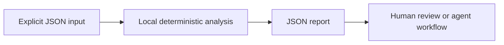

<div align="center">


[](https://github.com/XingCEO/robot-inertia-diff/actions/workflows/ci.yml)

[](LICENSE)


**Compare URDF mass properties after frame changes and conversion.**

[Try it](#quickstart) · [Input contract](#input-contract) · [Example report](examples/output.json) · [Contribute](CONTRIBUTING.md)

</div>

## The problem

Robot model conversion can preserve meshes while changing the dynamics. Comparing raw XML misses equivalent inertia tensors expressed in different inertial frames.

## How it works

Parse URDF link inertials, rotate each tensor into the link frame, then apply the parallel-axis theorem to compare inertia about the link origin. Report mass, center-of-mass and tensor deltas separately. Positive-definiteness checks flag physically suspect tensors before comparison.



## Quickstart

Requires Python 3.11 or later. The analyzer has **no runtime dependencies**, makes no network requests and runs no shell commands. Domain-specific interpretation (such as SQL rehearsal) is described below.

```bash
git clone https://github.com/XingCEO/robot-inertia-diff.git
cd robot-inertia-diff
python3 -m robot_inertia_diff examples/input.json
```

Optional installation into an isolated environment:

```bash
python3 -m venv .venv
. .venv/bin/activate
python -m pip install .
robot-inertia-diff examples/input.json
```

The package is installed from this checkout; no PyPI publication is claimed.

## Work with native files

Use existing files directly instead of wrapping them in a JSON string:

```bash
python3 -m robot_inertia_diff --before examples/before.urdf --after examples/after.urdf
```

The analyzer reads only the paths explicitly supplied. It does not crawl a repository or execute a Wasm module. Native file flags and the positional JSON envelope are mutually exclusive.

## Input contract

Use [the complete example](examples/input.json) as a starting point. Paths and strings in JSON are data unless the contract explicitly says they refer to local files.

| Field | Meaning |
| --- | --- |
| `before / after` | URDF XML strings with matching link coordinate conventions. |
| `tolerance` | Absolute numeric tolerance applied to mass, COM and tensor entries; default 1e-9. |

## Example result

Generated by running the committed example:

```json
{
  "changes": [
    {
      "kind": "physical_change",
      "link": "base",
      "mass_delta": 0.19999999999999996,
      "max_com_delta": 0.0,
      "max_tensor_delta": 0.0
    }
  ],
  "equivalent_within_tolerance": false,
  "physical_warnings": []
}
```

## Use from another tool

```python
import json
from robot_inertia_diff import analyze

with open("examples/input.json", encoding="utf-8") as stream:
    report = analyze(json.load(stream))
```

`analyze(data)` returns a JSON-serializable dictionary. The CLI accepts `-` for stdin, writes reports to stdout and input errors to stderr. Exit `0` means analysis completed, including reports containing findings; exit `2` means invalid input or an unreadable file. Gate CI on the report's documented fields, rather than assuming exit `0` means no findings. The JSON report is a v0.1 interface and may evolve before 1.0.

## Validation

```bash
python3 -m unittest discover -v
```

Tests cover the example, malformed CLI input, and the domain-specific boundary cases in [tests/test_core.py](tests/test_core.py). CI also installs the package and runs its console entry point on Python 3.11 and 3.13. Test success demonstrates these cases; it is not evidence of production deployment.

## Scope and limits

URDF input only; export MJCF or other formats to URDF first and inspect converter losses independently. Coordinates must share units and link frames. It compares per-link properties, not full articulated-system dynamics. Positive definiteness alone does not prove physical realizability. XML DOCTYPE and entities are rejected.

This is a focused experimental first release. Review findings before changing production systems. Inputs and reports may contain your own source or metadata; keep them in an appropriate local workspace.

## Related work and references

- [URDF inertial element](https://wiki.ros.org/urdf/XML/link)
- [MuJoCo modeling](https://mujoco.readthedocs.io/en/stable/modeling.html)

These projects and specifications inform the problem space. This repository is an independent implementation; it does not claim to replace the referenced systems or to have invented the underlying techniques.

## Contributing

A small real-world fixture with expected behavior is the most useful contribution. See [CONTRIBUTING.md](CONTRIBUTING.md). Please remove private data before filing an issue.

## License

[MIT](LICENSE) © 2026 XingCEO.
